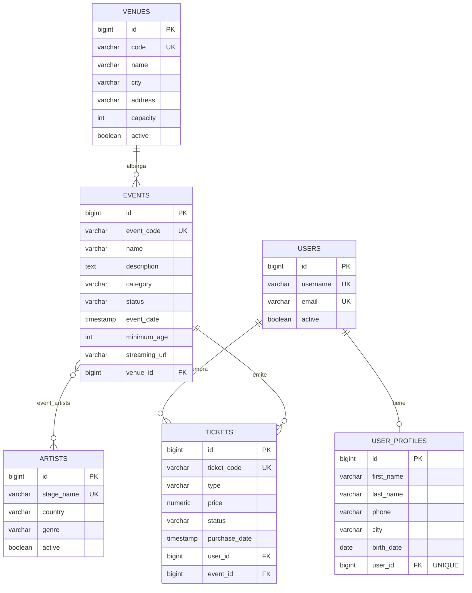

# PulsePass

Caso de estudio académico: backend de **PulsePass**, una plataforma de eventos, artistas y entradas, construido de forma incremental en tres fases:

| Fase | Capa | Qué aporta |
|---|---|---|
| 1 | Persistencia | Modelo relacional, entidades JPA, repositories, migraciones Flyway y pruebas de integración con PostgreSQL real |
| 2 | Servicios | Reglas de negocio, DTOs, mappers con MapStruct, transacciones, excepciones propias y unit tests |
| 3 | Controladores REST | Endpoints HTTP, validación de entrada, códigos de respuesta, manejo global de errores y pruebas con MockMvc |

Queda fuera del alcance: autenticación y autorización, pagos, frontend, paginación, OpenAPI y pruebas E2E.

**Tecnologías:** Java 21, Spring Boot 4, Spring MVC, Spring Data JPA, Bean Validation, PostgreSQL, Flyway, MapStruct, JUnit 5, Mockito, MockMvc y Testcontainers.

**Integrantes:** Isabella Guerra ([@igguerra](https://github.com/igguerra)) y Valeria Gamez ([@valegzt](https://github.com/valegzt))

## Contenido

- [Estructura del proyecto](#estructura-del-proyecto)
- [Modelo de dominio](#modelo-de-dominio)
- [Migraciones (Flyway)](#migraciones-flyway)
- [Consultas](#consultas)
- [Capa de servicios](#capa-de-servicios)
- [API REST](#api-rest)
- [Pruebas](#pruebas)
- [Flujo de trabajo del equipo](#flujo-de-trabajo-del-equipo)

## Estructura del proyecto

```
src/
├── main/
│   ├── java/edu/unimag/pulsepass/persistence/
│   │   ├── controller/    Controllers REST (uno por recurso)
│   │   ├── service/       Interfaces de servicio y TicketPriceCalculator
│   │   │   └── impl/      Implementaciones con las reglas de negocio
│   │   ├── dto/
│   │   │   ├── request/   CreateEventRequest, RegisterUserRequest, PurchaseTicketRequest
│   │   │   └── response/  DTOs de salida y ErrorResponse
│   │   ├── mapper/        Mappers MapStruct (entidad -> DTO)
│   │   ├── exception/     Excepciones de negocio y GlobalExceptionHandler
│   │   ├── repository/    Repositories (JpaRepository)
│   │   └── domain/        Entidades JPA y enums
│   └── resources/
│       ├── application.properties
│       └── db/migration/  V1, V2 y V3 (Flyway)
└── test/java/edu/unimag/pulsepass/persistence/
    ├── controller/        Pruebas de contrato HTTP (@WebMvcTest + MockMvc)
    ├── service/           Unit tests de servicios (Mockito)
    └── ...                Pruebas de integración de persistencia (Testcontainers)
```

Cada capa solo conoce a la que tiene debajo:

```
HTTP Request -> Controller -> Service -> Repository -> PostgreSQL
                    |             |
              valida la forma   aplica las reglas
              del request       de negocio
```

Configuración relevante (`application.properties`):

```properties
spring.jpa.hibernate.ddl-auto=validate
spring.jpa.open-in-view=false
```

Hibernate solo **valida** el esquema; quien lo crea y lo evoluciona es Flyway. La URL, el usuario y la contraseña de la base de datos no se configuran: en las pruebas los inyecta Testcontainers.

## Modelo de dominio



### Relaciones

| Relación | Cardinalidad | Cómo se implementa |
|---|---|---|
| Venue → Event | 1:N | `@ManyToOne(LAZY, optional = false)` en `Event`, con `venue_id NOT NULL` |
| Event ↔ Artist | N:M | `@ManyToMany` con `@JoinTable(name = "event_artists")` en `Event`; PK compuesta `(event_id, artist_id)` |
| User ↔ UserProfile | 1:1 | `@OneToOne` en `UserProfile`; `user_id` con FK y `UNIQUE` |
| User → Ticket | 1:N | `@ManyToOne(LAZY, optional = false)` en `Ticket` |
| Event → Ticket | 1:N | `@ManyToOne(LAZY, optional = false)` en `Ticket` |

### Enums

Todos se guardan **por nombre** con `@Enumerated(EnumType.STRING)` (nunca por ordinal) y además están restringidos con `CHECK` en PostgreSQL.

| Enum | Valores |
|---|---|
| `EventCategory` | MUSIC, SPORTS, TECHNOLOGY, EDUCATION, CULTURE, ENTERTAINMENT |
| `EventStatus` | DRAFT, PUBLISHED, SOLD_OUT, CANCELLED, FINISHED |
| `TicketType` | GENERAL, VIP, BACKSTAGE, STUDENT |
| `TicketStatus` | RESERVED, PAID, CANCELLED, USED |

### Decisiones de diseño

- **Ticket es una entidad, no un `@ManyToMany` entre User y Event**, porque tiene datos propios (`ticketCode`, `type`, `price`, `status`, `purchaseDate`) y porque un usuario puede tener varios tickets para el mismo evento.
- **La relación Event–Artist es unidireccional** (solo `Event` conoce a sus artistas). Así no hay que mantener sincronizados dos lados, y los eventos de un artista se obtienen con una consulta JPQL.
- **`Set` en lugar de `List`** para los artistas de un evento: un `Set` no admite repetidos, coherente con la PK compuesta de `event_artists`.
- **`Artist.equals()` y `hashCode()` usan `stageName`**, que es único, y no el `id`, porque el `id` es `null` hasta que se hace el `INSERT`.
- **Sin `CascadeType`**: los artistas y los usuarios se guardan antes y luego se relacionan.
- **`LAZY` en todas las relaciones `@ManyToOne`**, para no cargar datos que no se necesitan.
- **Precios con `BigDecimal` / `NUMERIC(12,2)`**, nunca `float` ni `double`.
- **Sin Lombok `@Data`** en las entidades: getters y setters escritos a mano.
- **`SOLD_OUT` no lo calcula la base de datos**: en la fase de persistencia era un estado asignado manualmente; desde la capa de servicios lo asigna `TicketService` cuando la compra llena la capacidad del venue.

## Migraciones (Flyway)

| Migración | Qué hace |
|---|---|
| `V1__create_schema.sql` | Crea `venues`, `artists`, `users`, `events`, `event_artists`, `user_profiles` y `tickets`, con PK, FK, UNIQUE, CHECK e índices para las consultas frecuentes (FK de `events`, `event_artists` y `tickets`, y `events(status, event_date)`) |
| `V2__insert_initial_artists.sql` | Inserta el catálogo inicial: Solar Beat, Neon Waves, Caribbean Sound, Ocean Drive y Digital Pulse |
| `V3__add_streaming_url_to_event.sql` | Agrega `streaming_url VARCHAR(500)` (nullable) a `events`, sin modificar V1 |

Una base vacía se reconstruye completa ejecutando las migraciones en orden. **Una migración ya aplicada no se edita**: cualquier cambio estructural nuevo va en una migración nueva (`V4__...`).

## Consultas

Se usan **Query Methods** para filtros simples y navegación de relaciones, y **JPQL con `@Query`** cuando hay JOIN sobre la N:M, `DISTINCT`, `COUNT` o varias asociaciones a la vez. No se usa SQL nativo.

| Repository | Método | Mecanismo | Requisito |
|---|---|---|---|
| `VenueRepository` | `findByCode` | Query Method | FR-VEN-001 |
| `EventRepository` | `findByEventCode` (con `@EntityGraph` para traer el venue) | Query Method | FR-EVT-001 |
| `EventRepository` | `findByStatusOrderByEventDateAsc` | Query Method | FR-EVT-005 |
| `EventRepository` | `findByVenueCode` | Query Method (navega `venue.code`) | FR-VEN-004 |
| `EventRepository` | `findEventsByArtist` | JPQL con JOIN y `DISTINCT` | FR-SRC-001, FR-ART-004 |
| `EventRepository` | `findEventsByCityAndArtist` | JPQL con dos JOIN | FR-SRC-002 |
| `EventRepository` | `findRecommendedEvents` | JPQL con filtros, `DISTINCT`, `LOWER ... LIKE` y orden | FR-SRC-003 |
| `ArtistRepository` | `findByStageName` | Query Method | FR-ART-002 |
| `UserRepository` | `findByEmailIgnoreCase` | Query Method | FR-USR-001 |
| `UserProfileRepository` | `findByUserId` | Query Method | FR-USR-004 |
| `TicketRepository` | `findByUserEmailIgnoreCase` | Query Method (Ticket → User → email) | FR-TKT-006 |
| `TicketRepository` | `findByUserEmailIgnoreCaseAndStatus` | Query Method | FR-TKT-006 |
| `TicketRepository` | `findByEventEventCodeAndStatus` | Query Method | FR-TKT-007 |
| `TicketRepository` | `countPaidTicketsByEventCode` | JPQL con `COUNT` | FR-TKT-008 |
| `TicketRepository` | `findTicketsForUpcomingEvents` | JPQL con orden cronológico | FR-SRC-004 |

**Tickets pagados por evento (FR-TKT-007):** el PRD permite Query Method o JPQL. Se eligió Query Method porque es un filtro de dos condiciones sobre una relación y Spring Data lo resuelve por el nombre; además el método recibe el estado como parámetro, así que sirve para cualquier `TicketStatus`, no solo `PAID`.

La capa de servicios agregó después algunos Query Methods de apoyo para sus reglas: `existsByEventCode`, `existsByUsername`, `existsByEmailIgnoreCase`, `findByUsername`, `findByTicketCode`, `findByStageNameIgnoreCase`, `findByActiveTrueOrderByNameAsc` (venues), `findByActiveTrueOrderByStageNameAsc` (artistas) y `findByUserEmailIgnoreCaseOrderByPurchaseDateDesc`.

## Capa de servicios

Cada servicio tiene una interfaz (`XService`) y una implementación (`XServiceImpl`) con `@Service`, dependencias `final` e inyección por constructor. Los servicios reciben y devuelven **DTOs** (`record`), nunca entidades JPA; la conversión la hacen los mappers de MapStruct (por ejemplo, `venue.code` -> `venueCode` y `ticket.user.email` -> `userEmail`).

| Servicio | Métodos |
|---|---|
| `VenueService` | `findByCode`, `findActiveVenues` |
| `ArtistService` | `findById`, `findByStageName`, `findActiveArtists` |
| `EventService` | `create`, `findByCode`, `findPublishedEvents`, `publish`, `addArtist`, `findByArtist` |
| `UserService` | `register`, `findByEmail`, `findByUsername` |
| `TicketService` | `purchase`, `findByCode`, `findByUserEmail`, `findPaidTicketsByEvent`, `cancel`, `markAsUsed` |

Las escrituras usan `@Transactional` y las lecturas `@Transactional(readOnly = true)`.

### Excepciones

| Excepción | Cuándo se lanza |
|---|---|
| `ResourceNotFoundException` | El recurso pedido no existe |
| `DuplicateResourceException` | Conflicto de unicidad (código de evento, username o email repetido) |
| `BusinessRuleException` | El recurso existe, pero la operación no es válida en su estado actual |

### Reglas de negocio principales

**Eventos**

- Al crear: `eventCode` único, venue existente y activo, fecha futura y `minimumAge >= 0`. Todo evento nuevo inicia en `DRAFT`; el request no controla el estado.
- Solo se publica un evento en `DRAFT`, con fecha futura y venue activo.
- No se asocia dos veces el mismo artista, ni se agregan artistas a eventos `CANCELLED` o `FINISHED`.

**Usuarios**

- `username` y `email` únicos (el email sin distinguir mayúsculas) y `birthDate` no futura.
- `User` y `UserProfile` se crean en la misma transacción.

**Tickets**

- La compra exige usuario existente y activo, evento `PUBLISHED` con fecha futura, edad mínima cumplida (calculada a la fecha del evento) y cupo disponible según la capacidad del venue.
- El ticket se crea en `PAID`, y si con esa compra se llena el venue, el evento pasa a `SOLD_OUT`. Todo ocurre en una sola transacción.
- Solo un ticket `PAID` puede cancelarse o marcarse como usado, y no se cancela después de la fecha del evento.
- El precio lo calcula `TicketPriceCalculator` con `BigDecimal` sobre una base de 100.00: `GENERAL` 100.00, `STUDENT` 70.00, `VIP` 200.00 y `BACKSTAGE` 400.00.

## API REST

La capa de controladores expone por HTTP los 20 métodos públicos de los servicios. Los controllers son delgados: reciben la petición, delegan en el servicio y devuelven un `ResponseEntity` con un DTO. No acceden a repositories, no contienen reglas de negocio y no tienen bloques `try/catch`.

La API no está versionada ni tiene autenticación: todos los endpoints son públicos en este MVP.

### Endpoints

**Venues** (`VenueController`)

| Método | Endpoint | Servicio | Éxito |
|---|---|---|---|
| GET | `/api/venues/{code}` | `findByCode` | 200 |
| GET | `/api/venues/active` | `findActiveVenues` | 200 |

**Eventos** (`EventController`)

| Método | Endpoint | Servicio | Éxito |
|---|---|---|---|
| POST | `/api/events` | `create` | 201 |
| GET | `/api/events/{eventCode}` | `findByCode` | 200 |
| GET | `/api/events/published` | `findPublishedEvents` | 200 |
| PATCH | `/api/events/{eventCode}/publish` | `publish` | 200 |
| POST | `/api/events/{eventCode}/artists/{artistId}` | `addArtist` | 200 |
| GET | `/api/events/by-artist?stageName=...` | `findByArtist` | 200 |

**Artistas** (`ArtistController`)

| Método | Endpoint | Servicio | Éxito |
|---|---|---|---|
| GET | `/api/artists/{id}` | `findById` | 200 |
| GET | `/api/artists/by-stage-name?stageName=...` | `findByStageName` | 200 |
| GET | `/api/artists/active` | `findActiveArtists` | 200 |

**Usuarios** (`UserController`)

| Método | Endpoint | Servicio | Éxito |
|---|---|---|---|
| POST | `/api/users` | `register` | 201 |
| GET | `/api/users/by-email?email=...` | `findByEmail` | 200 |
| GET | `/api/users/by-username?username=...` | `findByUsername` | 200 |

**Tickets** (`TicketController`)

| Método | Endpoint | Servicio | Éxito |
|---|---|---|---|
| POST | `/api/tickets` | `purchase` | 201 |
| GET | `/api/tickets/{ticketCode}` | `findByCode` | 200 |
| GET | `/api/tickets/by-user?email=...` | `findByUserEmail` | 200 |
| GET | `/api/events/{eventCode}/tickets/paid` | `findPaidTicketsByEvent` | 200 |
| PATCH | `/api/tickets/{ticketCode}/cancel` | `cancel` | 200 |
| PATCH | `/api/tickets/{ticketCode}/use` | `markAsUsed` | 200 |

### Ejemplo: crear un evento

```http
POST /api/events
Content-Type: application/json

{
  "eventCode": "CMF-2026",
  "name": "Caribbean Music Fest 2026",
  "description": "Festival de musica",
  "category": "MUSIC",
  "eventDate": "2026-12-15T20:00:00",
  "minimumAge": 18,
  "venueCode": "VEN-SMR-01"
}
```

Respuesta `201 Created`:

```json
{
  "id": 1,
  "eventCode": "CMF-2026",
  "name": "Caribbean Music Fest 2026",
  "description": "Festival de musica",
  "category": "MUSIC",
  "status": "DRAFT",
  "eventDate": "2026-12-15T20:00:00",
  "minimumAge": 18,
  "venueCode": "VEN-SMR-01",
  "venueName": "Marina Convention Center",
  "artists": []
}
```

Las asociaciones se expresan con identificadores de negocio (`venueCode`, `userEmail`, `eventCode`), nunca enviando objetos JPA anidados.

### Validación de entrada

Los tres request DTOs llevan anotaciones de Bean Validation, que se activan con `@Valid @RequestBody` en el controller. Si el request no las cumple, la API responde `400` **antes** de invocar el servicio.

| DTO | Campo | Validación |
|---|---|---|
| `CreateEventRequest` | `eventCode`, `name`, `venueCode` | `@NotBlank` |
| | `description` | `@Size(max = 1000)` |
| | `category`, `eventDate` | `@NotNull` |
| | `minimumAge` | `@NotNull`, `@Min(0)` |
| `RegisterUserRequest` | `username`, `firstName`, `lastName` | `@NotBlank` |
| | `email` | `@NotBlank`, `@Email` |
| | `birthDate` | `@NotNull` |
| `PurchaseTicketRequest` | `userEmail` | `@NotBlank`, `@Email` |
| | `eventCode` | `@NotBlank` |
| | `type` | `@NotNull` |

El límite entre capas es este:

| Valida el Controller (estructura) | Valida el Service (negocio) |
|---|---|
| Campo obligatorio, formato de email, longitud, valor mínimo, JSON mal formado | Usuario activo, evento existente y publicado, edad mínima, capacidad, transiciones de estado, duplicados |

### Manejo de errores

`GlobalExceptionHandler` (`@RestControllerAdvice`) centraliza la traducción de excepciones a HTTP. Todos los errores usan el mismo contrato, `ErrorResponse`:

```json
{
  "timestamp": "2026-10-10T20:00:00",
  "status": 404,
  "error": "Not Found",
  "message": "Event not found: CMF-2026",
  "details": {}
}
```

En los errores de validación, `details` trae un mensaje por cada campo inválido:

```json
{
  "timestamp": "2026-10-10T20:00:00",
  "status": 400,
  "error": "Bad Request",
  "message": "Validation Failed",
  "details": {
    "eventCode": "Event code is required",
    "venueCode": "Venue code is required"
  }
}
```

| Excepción o condición | Código | Significado |
|---|---|---|
| `MethodArgumentNotValidException` | 400 | El request no cumple Bean Validation |
| `HttpMessageNotReadableException` | 400 | JSON mal formado o valor de enum inexistente |
| `ResourceNotFoundException` | 404 | El recurso no existe |
| `DuplicateResourceException` | 409 | Conflicto de unicidad |
| `BusinessRuleException` | 409 | Regla de negocio incumplida |
| Cualquier otra excepción | 500 | Error inesperado, con mensaje genérico y sin stack trace |

### Decisiones de diseño de la API

- **`POST` de creación devuelve `201`** (evento, usuario, ticket); las consultas y los `PATCH` devuelven `200`.
- **`POST /api/events/{eventCode}/artists/{artistId}` devuelve `200` y no `201`**, porque responde con el evento actualizado y no con un recurso nuevo.
- **`PATCH` para las transiciones de estado** (`publish`, `cancel`, `use`): modifican una parte de un recurso existente y no llevan cuerpo; la acción va en la ruta.
- **`@PathVariable` para identificar un recurso** (`/api/venues/{code}`) y **`@RequestParam` para búsquedas** (`?stageName=...`, `?email=...`), cuyos valores pueden llevar espacios o símbolos.
- **`GET /api/events/{eventCode}/tickets/paid` vive en `TicketController`**, aunque la ruta empiece por `/events`, porque delega en `TicketService`. Por eso ese controller usa `@RequestMapping("/api")` y cada método declara su ruta completa.
- **Los listados usan `EventSummaryResponse`**, una versión corta del evento sin descripción ni artistas.
- **El error 500 no expone `ex.getMessage()`**, para no filtrar detalles internos al cliente.

## Pruebas

El proyecto tiene **117 pruebas** repartidas en tres niveles, uno por capa:

| Capa | Tipo de prueba | Herramientas | ¿Necesita Docker? | Pruebas |
|---|---|---|---|---|
| Persistencia | Integración | `@SpringBootTest` + Testcontainers (PostgreSQL real) | Sí | 38 |
| Servicios | Unitarias | JUnit 5 + Mockito + AssertJ, repositories simulados | No | 47 |
| Controladores | Contrato HTTP | `@WebMvcTest` + MockMvc, servicios simulados con `@MockitoBean` | No | 32 |

En cada nivel se simula la capa inmediatamente inferior, de modo que una falla señala con claridad en qué capa está el problema.

### Cómo ejecutarlas

**Requisitos:** JDK 21 y, para la suite completa, **Docker corriendo** (Docker Desktop abierto en Windows). No hace falta instalar PostgreSQL: Testcontainers descarga y arranca `postgres:17-alpine` por su cuenta. La primera ejecución tarda más porque descarga las dependencias y la imagen.

Suite completa:

```bash
# Linux / macOS
./mvnw clean test

# Windows (PowerShell)
.\mvnw.cmd clean test
```

El resultado esperado es `BUILD SUCCESS`.

Solo las pruebas que **no necesitan Docker** (servicios y controladores):

```bash
./mvnw test -Dtest="*ControllerTest,*ServiceImplTest,TicketPriceCalculatorTest"
```

Solo los controladores, o una sola clase:

```bash
./mvnw test -Dtest="*ControllerTest"
./mvnw test -Dtest=EventControllerTest
```

Para comprobar únicamente que el código compila:

```bash
./mvnw test-compile
```

### Probar la API manualmente

`TestPersistenceApplication` arranca la aplicación con un PostgreSQL temporal de Testcontainers (requiere Docker). Se puede ejecutar desde el IDE o con:

```bash
./mvnw spring-boot:test-run
```

La API queda disponible en `http://localhost:8080`. La base arranca solo con los cinco artistas de la migración V2, así que `GET /api/artists/active` responde de inmediato. Como el MVP no incluye un endpoint para crear venues, para probar la creación de eventos hay que insertar antes un venue directamente en la base.

### Pruebas de controladores

Cada controller tiene su clase de prueba. En todas se valida el status HTTP, el `Content-Type` y los campos relevantes del JSON con `jsonPath`, y se verifica la interacción con el servicio mediante `verify(...)`.

| Clase | Pruebas | Qué cubre |
|---|---|---|
| `VenueControllerTest` | 3 | Venue existente (200), inexistente (404) y venues activos (200) |
| `EventControllerTest` | 9 | Crear (201), request inválido (400), consultar (200 y 404), publicados (200), publicar (200 y 409), asociar artista (200) y buscar por artista (200) |
| `ArtistControllerTest` | 4 | Por ID (200 y 404), por `stageName` (200) y activos (200) |
| `UserControllerTest` | 5 | Registrar (201), email inválido (400), username duplicado (409), por email (200) y por username (200) |
| `TicketControllerTest` | 11 | Comprar (201, 400, 404 y 409), consultar (200), por usuario (200), `PAID` por evento (200), cancelar (200 y 409) y usar (200 y 409) |

Dos casos resumen la frontera entre capas:

- **Request inválido (400):** se usa `verify(service, never())`, que demuestra que el request nunca llegó al servicio.
- **Regla de negocio incumplida (409) o recurso inexistente (404):** el servicio sí es invocado y es él quien lanza la excepción; el `GlobalExceptionHandler` la convierte en respuesta.

### Pruebas de servicios

| Clase | Pruebas | Qué cubre |
|---|---|---|
| `VenueServiceImplTest` | 3 | Consulta por código, venue inexistente y venues activos |
| `ArtistServiceImplTest` | 4 | Consulta por ID, artista inexistente (por ID y por `stageName`) y activos |
| `EventServiceImplTest` | 17 | Reglas de creación, publicación y asociación de artistas, y consultas |
| `UserServiceImplTest` | 6 | Registro con perfil, duplicados de username y email, fecha de nacimiento y consultas |
| `TicketServiceImplTest` | 12 | Compra (usuario, evento, edad, capacidad, `SOLD_OUT`), cancelación y uso |
| `TicketPriceCalculatorTest` | 5 | Precio por tipo de ticket |

En los caminos inválidos se usa `verify(..., never())` para comprobar que no se guarda nada.

### Pruebas de persistencia

Levantan un **PostgreSQL real con Testcontainers** (no se usa H2), dejan que Flyway construya el esquema y luego ejecutan los repositories. Cada prueba usa `@Transactional`, así que los datos se revierten y no se contaminan entre sí.

| Clase | Qué cubre |
|---|---|
| `FlywayMigrationTest` | V1, V2 y V3 se aplican desde una base vacía; los 5 artistas iniciales; `streaming_url` existe y admite `NULL` |
| `PersistenceApplicationTests` | El contexto de Spring arranca con `ddl-auto=validate` |
| `VenueRepositoryTest` | Persistencia, `code` único y `capacity > 0` |
| `EventRepositoryTest` | Evento con su venue, `eventCode` único, enums guardados por nombre, eventos publicados ordenados, eventos por `venue.code` y `streaming_url` opcional |
| `ArtistRepositoryTest` | Persistencia, `stageName` único, incluido un nombre ya sembrado por V2 |
| `EventArtistTest` | Relación N:M: tres artistas por evento, sin duplicar el par, PK compuesta rechazando duplicados aunque se salte JPA, y un artista en varios eventos |
| `EventSearchTest` | Consultas JPQL de eventos por artista, por ciudad y artista, y recomendados |
| `UserRepositoryTest` | Persistencia, `username` y `email` únicos, búsqueda por email ignorando mayúsculas |
| `UserProfileRepositoryTest` | Datos del perfil recuperables desde el usuario y segundo perfil rechazado (1:1) |
| `TicketRepositoryTest` | FK obligatorias a usuario y evento, `ticketCode` único y precio negativo rechazado |
| `TicketQueryTest` | Tickets por email y estado, tickets pagados por evento, conteo de `PAID` y tickets de eventos futuros |

### Trazabilidad

**Persistencia**

| Criterio del PRD | Dónde se verifica |
|---|---|
| QT-001 Flyway desde base vacía | `FlywayMigrationTest` |
| QT-002 Hibernate solo valida | `ddl-auto=validate` en todas las pruebas de contexto |
| QT-003 Venue 1:N Event | `EventRepositoryTest` (`retrievesEventWithItsVenue`, `findsEventsByVenueCode`) |
| QT-004 User 1:1 UserProfile | `UserProfileRepositoryTest` |
| QT-005 Event N:M Artist | `EventArtistTest` |
| QT-006 Ticket → User y Event | `TicketRepositoryTest` |
| QT-007 Query Methods | `EventRepositoryTest`, `UserRepositoryTest`, `TicketQueryTest` |
| QT-008 JPQL con JOIN y COUNT | `EventSearchTest`, `TicketQueryTest` |
| QT-009 UNIQUE con `saveAndFlush` | Pruebas `rejectsDuplicate...` de cada repository |
| QT-010 `mvn clean test` en verde | `./mvnw clean test` |

**Controladores**

| Criterio del PRD | Dónde se verifica |
|---|---|
| QT-CTRL-001 Cada controller tiene su clase de pruebas | Las cinco clases `*ControllerTest` |
| QT-CTRL-002 Los servicios son mocks | `@MockitoBean` en cada clase |
| QT-CTRL-003 a 005 Status, `Content-Type` y campos JSON | `status()`, `content().contentType(...)` y `jsonPath(...)` en todas las pruebas |
| QT-CTRL-006 Interacción con el servicio | `verify(service)...` en todas las pruebas |
| QT-CTRL-007 Request inválido no invoca el servicio | `verify(service, never())` en las pruebas de 400 de Event, User y Ticket |
| QT-CTRL-008 Respuestas 404 | Venue, Event, Artist y Ticket |
| QT-CTRL-009 Respuestas 409 | Event (publicar), User (duplicado) y Ticket (compra, cancelar, usar) |
| QT-CTRL-010 Bean Validation con 400 | Event, User y Ticket |
| QT-CTRL-011 `ErrorResponse` | Pruebas de 400, 404 y 409 |
| QT-CTRL-012 `mvn clean test` en verde | `./mvnw clean test` |

## Flujo de trabajo del equipo

En cada fase se subió primero a `main` una base común pequeña (dependencias, excepciones, contratos compartidos) y después el trabajo se dividió por bloques, cada uno en su propia rama y con Pull Request revisado por la otra persona antes de integrarse.

| Fase | Rama | Contenido |
|---|---|---|
| Persistencia | `main` (inicial) | Esqueleto, migraciones V1–V3, `Venue` y `Event` |
| | `feature/artist` | `Artist`, relación N:M con `Event` y consultas JPQL de búsqueda |
| | `feature/user-profile` | `User`, `UserProfile` y su relación 1:1 |
| | `feature/ticket` | `Ticket`, sus enums, `TicketRepository` y consultas |
| Servicios | `main` (base) | MapStruct en el `pom.xml`, las tres excepciones y métodos de repository adicionales |
| | `feature/event-user-services` | Servicios, DTOs, mappers y tests de `Event`, `Artist`, `Venue` y `User` |
| | `feature/ticket-service` | `TicketService`, `TicketPriceCalculator` y sus tests |
| Controladores | `main` (base) | Dependencias web y de validación, `ErrorResponse`, `GlobalExceptionHandler` y validaciones en los request DTOs |
| | `feature/event-venue-artist-controllers` | `EventController`, `VenueController`, `ArtistController` y sus tests |
| | `feature/ticket-user-controllers` | `TicketController`, `UserController` y sus tests |

Como cada bloque crea sus propios archivos, las ramas se integran sin conflictos. Los mensajes de commit y las pruebas hacen referencia a los identificadores del PRD (por ejemplo, `FR-TKT-003` o `TEST-CTRL-EVT-001`) cuando corresponde.
