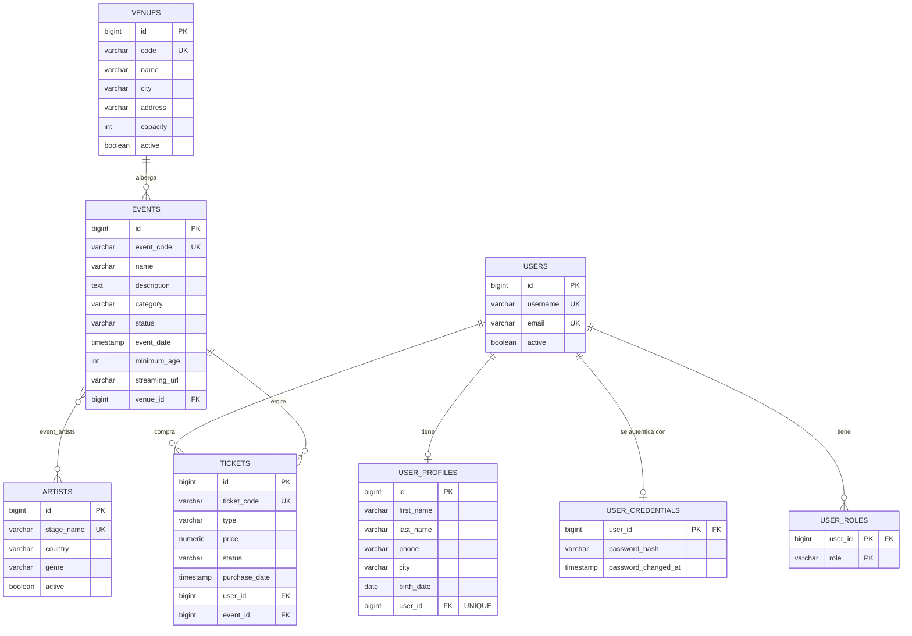

# PulsePass

Caso de estudio académico: **PulsePass**, una plataforma de eventos, artistas y entradas. Se construyó de forma incremental en cinco fases, primero el backend capa por capa y al final el cliente web:

| Fase | Capa | Qué aporta |
|---|---|---|
| 1 | Persistencia | Modelo relacional, entidades JPA, repositories, migraciones Flyway y pruebas de integración con PostgreSQL real |
| 2 | Servicios | Reglas de negocio, DTOs, mappers con MapStruct, transacciones, excepciones propias y unit tests |
| 3 | Controladores REST | Endpoints HTTP, validación de entrada, códigos de respuesta, manejo global de errores y pruebas con MockMvc |
| 4 | Seguridad | Credenciales con BCrypt, roles (USER, STAFF, ADMIN), login con JWT, autorización por ruta y por dueño del recurso, respuestas 401 y 403 |
| 5 | Frontend y E2E | Cliente web en React + TypeScript que consume la API real, y pruebas E2E manuales con Postman contra la aplicación y PostgreSQL |

Queda fuera del alcance: pagos reales, refresh token, paginación, OpenAPI, gestión de venues y artistas (solo lectura) y despliegue.

**Backend:** Java 21, Spring Boot 4, Spring MVC, Spring Data JPA, Spring Security, JJWT, Bean Validation, PostgreSQL 17, Flyway, MapStruct, JUnit 5, Mockito, MockMvc y Testcontainers.

**Frontend:** React 19, TypeScript (strict), Vite 8, React Router 8, TanStack Query 5, React Hook Form, zod 4, Tailwind CSS 4, Vitest, Testing Library y MSW. Gestor de paquetes: pnpm.

**Integrantes:** Isabella Guerra ([@igguerra](https://github.com/igguerra)) y Valeria Gamez ([@valegzt](https://github.com/valegzt))

## Contenido

- [Cómo ejecutar el proyecto](#cómo-ejecutar-el-proyecto)
- [Estructura del proyecto](#estructura-del-proyecto)
- [Modelo de dominio](#modelo-de-dominio)
- [Migraciones (Flyway)](#migraciones-flyway)
- [Consultas](#consultas)
- [Capa de servicios](#capa-de-servicios)
- [API REST](#api-rest)
- [Seguridad](#seguridad)
- [Frontend](#frontend)
- [Pruebas](#pruebas)
- [Flujo de trabajo del equipo](#flujo-de-trabajo-del-equipo)

## Cómo ejecutar el proyecto

### Requisitos

- JDK 21.
- PostgreSQL 17, ya sea en Docker (recomendado) o instalado localmente.
- Node.js 22 (o 20.19 o superior) y pnpm, para el frontend.
- Docker Desktop abierto, solo si se van a correr las pruebas de persistencia (Testcontainers).

### 1. Variables de entorno del backend

Copiar `.env.example` como `.env` en la raíz del repositorio y llenarlo:

```properties
PULSEPASS_JWT_SECRET_BASE64=<clave de al menos 256 bits en Base64>
PULSEPASS_JWT_ISSUER=pulsepass-api
PULSEPASS_E2E_DB_PASSWORD=<clave de la base>
# Solo si PostgreSQL está instalado localmente en el puerto 5432:
# PULSEPASS_E2E_DB_URL=jdbc:postgresql://localhost:5432/pulsepass_e2e
```

Spring lee este archivo con `spring.config.import=optional:file:.env[.properties]`. **El `.env` nunca se sube al repositorio** (está en `.gitignore`).

Una clave válida se genera, por ejemplo, con `openssl rand -base64 32`.

### 2. Base de datos

Con Docker (puerto 5433, el que usa el perfil `e2e` por defecto):

```bash
docker run -d --name pulsepass-e2e-db -e POSTGRES_DB=pulsepass_e2e -e POSTGRES_USER=pulsepass_e2e -e POSTGRES_PASSWORD=<tu clave del .env> -p 5433:5432 postgres:17-alpine
```

Sin Docker: crear en PostgreSQL local el usuario `pulsepass_e2e` con la clave del `.env` y la base `pulsepass_e2e`, y descomentar `PULSEPASS_E2E_DB_URL` en el `.env`.

### 3. Backend

```bash
# Linux / macOS
./mvnw spring-boot:run "-Dspring-boot.run.profiles=e2e"

# Windows (PowerShell)
.\mvnw.cmd spring-boot:run "-Dspring-boot.run.profiles=e2e"
```

La primera vez Flyway crea las tablas (V1 a V4). La API queda en `http://localhost:8080`.

Luego se cargan los datos de prueba (venues y eventos) con `tests/e2e/fixtures/seed-e2e.sql`. Los pasos detallados, con Docker, están en [`tests/e2e/fixtures/README.md`](tests/e2e/fixtures/README.md); sin Docker, el mismo archivo se ejecuta con `psql -U pulsepass_e2e -d pulsepass_e2e -f tests/e2e/fixtures/seed-e2e.sql`.

### 4. Usuarios y roles

El registro (`POST /api/users` o la página **Crear cuenta**) siempre crea usuarios con rol USER. Para tener un ADMIN y un STAFF se registran `e2e_admin` y `e2e_staff` y luego se ejecuta `tests/e2e/fixtures/promote-roles.sql`. Las contraseñas las elige cada quien al registrarse y no se guardan en el repositorio.

### 5. Frontend

En otra terminal:

```bash
cd pulsepass-web
pnpm install
pnpm dev
```

La aplicación queda en `http://localhost:5173`. No hace falta crear un `.env` en el frontend: por defecto llama a `/api`, y el proxy de Vite reenvía esas peticiones al backend en `localhost:8080` (ver [Frontend](#frontend)).

## Estructura del proyecto

```
pulsepass/
├── src/                   Backend (Spring Boot)
├── pulsepass-web/         Frontend (React + TypeScript)
├── tests/e2e/             Pruebas E2E manuales: colección Postman, fixtures SQL y bitácora
├── .env.example           Plantilla de variables del backend
└── pom.xml
```

Backend:

```
src/
├── main/
│   ├── java/edu/unimag/pulsepass/persistence/
│   │   ├── security/      Filtro JWT, SecurityConfig, AuthorizationService, 401 y 403
│   │   ├── controller/    Controllers REST (uno por recurso, más AuthController)
│   │   ├── service/       Interfaces de servicio y TicketPriceCalculator
│   │   │   └── impl/      Implementaciones con las reglas de negocio
│   │   ├── dto/
│   │   │   ├── request/   CreateEventRequest, RegisterUserRequest, PurchaseTicketRequest, LoginRequest
│   │   │   └── response/  DTOs de salida, AuthResponse y ErrorResponse
│   │   ├── mapper/        Mappers MapStruct (entidad -> DTO)
│   │   ├── exception/     Excepciones de negocio y GlobalExceptionHandler
│   │   ├── repository/    Repositories (JpaRepository)
│   │   └── domain/        Entidades JPA y enums
│   └── resources/
│       ├── application.properties
│       ├── application-e2e.properties   Conexión a la base pulsepass_e2e
│       └── db/migration/  V1 a V4 (Flyway)
└── test/java/edu/unimag/pulsepass/persistence/
    ├── security/          Pruebas de JwtService, del filtro y de AuthorizationService
    ├── controller/        Pruebas de contrato HTTP (@WebMvcTest + MockMvc, con seguridad)
    ├── service/           Unit tests de servicios (Mockito)
    └── ...                Pruebas de integración de persistencia (Testcontainers)
```

Cada capa solo conoce a la que tiene debajo:

```
HTTP Request -> Filtro JWT -> Controller -> Service -> Repository -> PostgreSQL
                    |              |            |
              quién eres y    valida la forma  aplica las reglas
              qué rol tienes  del request      de negocio y de dueño
```

| Capa | Para qué sirve |
|---|---|
| `security` | Lee y valida el token, decide qué rol necesita cada ruta y revisa quién es el dueño de un recurso |
| `controller` | Recibe la petición HTTP, valida la forma con `@Valid` y delega en el servicio |
| `dto` | Define la forma de lo que entra y sale de la API: es el contrato con el frontend |
| `service` | Aplica las reglas de negocio dentro de transacciones |
| `mapper` | Convierte entidades en DTO, para no exponer las entidades |
| `repository` | Consulta y guarda en PostgreSQL con Spring Data JPA |
| `domain` | Entidades JPA (las tablas en Java) y enums |
| `exception` | Traduce las excepciones a códigos HTTP con un JSON uniforme |

Configuración relevante (`application.properties`):

```properties
spring.jpa.hibernate.ddl-auto=validate
spring.jpa.open-in-view=false
spring.config.import=optional:file:.env[.properties]

pulsepass.security.jwt.issuer=${PULSEPASS_JWT_ISSUER:pulsepass-api}
pulsepass.security.jwt.secret-base64=${PULSEPASS_JWT_SECRET_BASE64}
pulsepass.security.jwt.access-token-ttl=PT15M
```

Hibernate solo **valida** el esquema; quien lo crea y lo evoluciona es Flyway. La conexión a la base no está en `application.properties`: en las pruebas la inyecta Testcontainers y para ejecutar la aplicación la define el perfil `e2e` (`application-e2e.properties`), que lee la URL, el usuario y la clave de variables de entorno.

## Modelo de dominio



### Relaciones

| Relación | Cardinalidad | Cómo se implementa |
|---|---|---|
| Venue → Event | 1:N | `@ManyToOne(LAZY, optional = false)` en `Event`, con `venue_id NOT NULL` |
| Event ↔ Artist | N:M | `@ManyToMany` con `@JoinTable(name = "event_artists")` en `Event`; PK compuesta `(event_id, artist_id)` |
| User ↔ UserProfile | 1:1 | `@OneToOne` en `UserProfile`; `user_id` con FK y `UNIQUE` |
| User → Ticket | 1:N | `@ManyToOne(LAZY, optional = false)` en `Ticket` |
| Event → Ticket | 1:N | `@ManyToOne(LAZY, optional = false)` en `Ticket` |
| User ↔ UserCredential | 1:1 | `user_credentials.user_id` es PK y FK a `users`; guarda el hash BCrypt, nunca la clave |
| User → roles | 1:N | Tabla `user_roles` con PK compuesta `(user_id, role)`: un usuario puede tener varios roles |

### Enums

Todos se guardan **por nombre** con `@Enumerated(EnumType.STRING)` (nunca por ordinal) y además están restringidos con `CHECK` en PostgreSQL.

| Enum | Valores |
|---|---|
| `EventCategory` | MUSIC, SPORTS, TECHNOLOGY, EDUCATION, CULTURE, ENTERTAINMENT |
| `EventStatus` | DRAFT, PUBLISHED, SOLD_OUT, CANCELLED, FINISHED |
| `TicketType` | GENERAL, VIP, BACKSTAGE, STUDENT |
| `TicketStatus` | RESERVED, PAID, CANCELLED, USED |
| `Role` | USER, STAFF, ADMIN |

### Decisiones de diseño

- **Ticket es una entidad, no un `@ManyToMany` entre User y Event**, porque tiene datos propios (`ticketCode`, `type`, `price`, `status`, `purchaseDate`) y porque un usuario puede tener varios tickets para el mismo evento.
- **La relación Event–Artist es unidireccional** (solo `Event` conoce a sus artistas). Así no hay que mantener sincronizados dos lados, y los eventos de un artista se obtienen con una consulta JPQL.
- **`Set` en lugar de `List`** para los artistas de un evento: un `Set` no admite repetidos, coherente con la PK compuesta de `event_artists`.
- **`Artist.equals()` y `hashCode()` usan `stageName`**, que es único, y no el `id`, porque el `id` es `null` hasta que se hace el `INSERT`.
- **Sin `CascadeType`**: los artistas y los usuarios se guardan antes y luego se relacionan.
- **`LAZY` en todas las relaciones `@ManyToOne`**, para no cargar datos que no se necesitan.
- **Precios con `BigDecimal` / `NUMERIC(12,2)`**, nunca `float` ni `double`.
- **Sin Lombok `@Data`** en las entidades: getters y setters escritos a mano.
- **`SOLD_OUT` no lo calcula la base de datos**: en la fase de persistencia era un estado asignado manualmente; desde la capa de servicios lo asigna `TicketService` cuando la compra llena la capacidad del venue.

## Migraciones (Flyway)

| Migración | Qué hace |
|---|---|
| `V1__create_schema.sql` | Crea `venues`, `artists`, `users`, `events`, `event_artists`, `user_profiles` y `tickets`, con PK, FK, UNIQUE, CHECK e índices para las consultas frecuentes (FK de `events`, `event_artists` y `tickets`, y `events(status, event_date)`) |
| `V2__insert_initial_artists.sql` | Inserta el catálogo inicial: Solar Beat, Neon Waves, Caribbean Sound, Ocean Drive y Digital Pulse |
| `V3__add_streaming_url_to_event.sql` | Agrega `streaming_url VARCHAR(500)` (nullable) a `events`, sin modificar V1 |
| `V4__security_credentials_roles.sql` | Crea `user_credentials` (hash de la clave) y `user_roles` (roles con `CHECK` en USER, STAFF y ADMIN), sin modificar las tablas existentes |

Una base vacía se reconstruye completa ejecutando las migraciones en orden. **Una migración ya aplicada no se edita**: cualquier cambio estructural nuevo va en una migración nueva (`V5__...`).

## Consultas

Se usan **Query Methods** para filtros simples y navegación de relaciones, y **JPQL con `@Query`** cuando hay JOIN sobre la N:M, `DISTINCT`, `COUNT` o varias asociaciones a la vez. No se usa SQL nativo.

| Repository | Método | Mecanismo | Requisito |
|---|---|---|---|
| `VenueRepository` | `findByCode` | Query Method | FR-VEN-001 |
| `EventRepository` | `findByEventCode` (con `@EntityGraph` para traer el venue) | Query Method | FR-EVT-001 |
| `EventRepository` | `findByStatusOrderByEventDateAsc` | Query Method | FR-EVT-005 |
| `EventRepository` | `findByVenueCode` | Query Method (navega `venue.code`) | FR-VEN-004 |
| `EventRepository` | `findEventsByArtist` | JPQL con JOIN y `DISTINCT` | FR-SRC-001, FR-ART-004 |
| `EventRepository` | `findEventsByCityAndArtist` | JPQL con dos JOIN | FR-SRC-002 |
| `EventRepository` | `findRecommendedEvents` | JPQL con filtros, `DISTINCT`, `LOWER ... LIKE` y orden | FR-SRC-003 |
| `ArtistRepository` | `findByStageName` | Query Method | FR-ART-002 |
| `UserRepository` | `findByEmailIgnoreCase` | Query Method | FR-USR-001 |
| `UserProfileRepository` | `findByUserId` | Query Method | FR-USR-004 |
| `TicketRepository` | `findByUserEmailIgnoreCase` | Query Method (Ticket → User → email) | FR-TKT-006 |
| `TicketRepository` | `findByUserEmailIgnoreCaseAndStatus` | Query Method | FR-TKT-006 |
| `TicketRepository` | `findByEventEventCodeAndStatus` | Query Method | FR-TKT-007 |
| `TicketRepository` | `countPaidTicketsByEventCode` | JPQL con `COUNT` | FR-TKT-008 |
| `TicketRepository` | `findTicketsForUpcomingEvents` | JPQL con orden cronológico | FR-SRC-004 |

**Tickets pagados por evento (FR-TKT-007):** el PRD permite Query Method o JPQL. Se eligió Query Method porque es un filtro de dos condiciones sobre una relación y Spring Data lo resuelve por el nombre; además el método recibe el estado como parámetro, así que sirve para cualquier `TicketStatus`, no solo `PAID`.

La capa de servicios agregó después algunos Query Methods de apoyo para sus reglas: `existsByEventCode`, `existsByUsername`, `existsByEmailIgnoreCase`, `findByUsername`, `findByTicketCode`, `findByStageNameIgnoreCase`, `findByActiveTrueOrderByNameAsc` (venues), `findByActiveTrueOrderByStageNameAsc` (artistas) y `findByUserEmailIgnoreCaseOrderByPurchaseDateDesc`.

## Capa de servicios

Cada servicio tiene una interfaz (`XService`) y una implementación (`XServiceImpl`) con `@Service`, dependencias `final` e inyección por constructor. Los servicios reciben y devuelven **DTOs** (`record`), nunca entidades JPA; la conversión la hacen los mappers de MapStruct (por ejemplo, `venue.code` -> `venueCode` y `ticket.user.email` -> `userEmail`).

| Servicio | Métodos |
|---|---|
| `VenueService` | `findByCode`, `findActiveVenues` |
| `ArtistService` | `findById`, `findByStageName`, `findActiveArtists` |
| `EventService` | `create`, `findByCode`, `findPublishedEvents`, `publish`, `addArtist`, `findByArtist` |
| `UserService` | `register`, `findByEmail`, `findByUsername` |
| `AuthService` | `login`, `currentUser` |
| `TicketService` | `purchase`, `findByCode`, `findByUserEmail`, `findPaidTicketsByEvent`, `cancel`, `markAsUsed` |

Las escrituras usan `@Transactional` y las lecturas `@Transactional(readOnly = true)`.

### Excepciones

| Excepción | Cuándo se lanza |
|---|---|
| `ResourceNotFoundException` | El recurso pedido no existe |
| `DuplicateResourceException` | Conflicto de unicidad (código de evento, username o email repetido) |
| `BusinessRuleException` | El recurso existe, pero la operación no es válida en su estado actual |

### Reglas de negocio principales

**Eventos**

- Al crear: `eventCode` único, venue existente y activo, fecha futura y `minimumAge >= 0`. Todo evento nuevo inicia en `DRAFT`; el request no controla el estado.
- Solo se publica un evento en `DRAFT`, con fecha futura y venue activo.
- No se asocia dos veces el mismo artista, ni se agregan artistas a eventos `CANCELLED` o `FINISHED`.

**Usuarios**

- `username` y `email` únicos (el email sin distinguir mayúsculas) y `birthDate` no futura.
- `User`, `UserProfile` y la credencial se crean en la misma transacción. La clave se guarda como hash BCrypt y todo usuario nuevo recibe el rol `USER`; los roles `STAFF` y `ADMIN` se asignan por SQL.
- Solo el propio usuario o un ADMIN pueden consultarlo por email o por username.

**Tickets**

- La compra exige que el `userEmail` sea el del usuario autenticado (nadie compra a nombre de otro, ni siquiera un ADMIN), usuario existente y activo, evento `PUBLISHED` con fecha futura, edad mínima cumplida (calculada a la fecha del evento) y cupo disponible según la capacidad del venue.
- El ticket se crea en `PAID`, y si con esa compra se llena el venue, el evento pasa a `SOLD_OUT`. Todo ocurre en una sola transacción.
- Solo un ticket `PAID` puede cancelarse o marcarse como usado, y no se cancela después de la fecha del evento.
- Ver los tickets de un usuario o cancelar uno exige ser el dueño o ADMIN; ver un ticket también se le permite a STAFF.
- El precio lo calcula `TicketPriceCalculator` con `BigDecimal` sobre una base de 100.00: `GENERAL` 100.00, `STUDENT` 70.00, `VIP` 200.00 y `BACKSTAGE` 400.00.

## API REST

La capa de controladores expone por HTTP los 20 métodos públicos de los servicios, más el login y `GET /api/auth/me` de la fase de seguridad. Los controllers son delgados: reciben la petición, delegan en el servicio y devuelven un `ResponseEntity` con un DTO. No acceden a repositories, no contienen reglas de negocio y no tienen bloques `try/catch`.

La API no está versionada. Desde la fase 4 exige autenticación con JWT salvo en las rutas públicas; la columna **Acceso** de cada tabla dice quién puede usar cada endpoint (ver [Seguridad](#seguridad)).

### Endpoints

**Venues** (`VenueController`)

| Método | Endpoint | Servicio | Acceso | Éxito |
|---|---|---|---|---|
| GET | `/api/venues/{code}` | `findByCode` | Público | 200 |
| GET | `/api/venues/active` | `findActiveVenues` | Público | 200 |

**Eventos** (`EventController`)

| Método | Endpoint | Servicio | Acceso | Éxito |
|---|---|---|---|---|
| POST | `/api/events` | `create` | ADMIN | 201 |
| GET | `/api/events/{eventCode}` | `findByCode` | Público (un evento no publicado solo lo ven STAFF y ADMIN; a los demás les responde 404) | 200 |
| GET | `/api/events/published` | `findPublishedEvents` | Público | 200 |
| PATCH | `/api/events/{eventCode}/publish` | `publish` | ADMIN | 200 |
| POST | `/api/events/{eventCode}/artists/{artistId}` | `addArtist` | ADMIN | 200 |
| GET | `/api/events/by-artist?stageName=...` | `findByArtist` | Público (sin privilegios, solo eventos publicados) | 200 |

**Artistas** (`ArtistController`)

| Método | Endpoint | Servicio | Acceso | Éxito |
|---|---|---|---|---|
| GET | `/api/artists/{id}` | `findById` | Público | 200 |
| GET | `/api/artists/by-stage-name?stageName=...` | `findByStageName` | Público | 200 |
| GET | `/api/artists/active` | `findActiveArtists` | Público | 200 |

**Usuarios** (`UserController`)

| Método | Endpoint | Servicio | Acceso | Éxito |
|---|---|---|---|---|
| POST | `/api/users` | `register` | Público | 201 |
| GET | `/api/users/by-email?email=...` | `findByEmail` | El propio usuario o ADMIN | 200 |
| GET | `/api/users/by-username?username=...` | `findByUsername` | El propio usuario o ADMIN | 200 |

**Tickets** (`TicketController`)

| Método | Endpoint | Servicio | Acceso | Éxito |
|---|---|---|---|---|
| POST | `/api/tickets` | `purchase` | USER, y solo a su propio nombre | 201 |
| GET | `/api/tickets/{ticketCode}` | `findByCode` | Dueño, STAFF o ADMIN | 200 |
| GET | `/api/tickets/by-user?email=...` | `findByUserEmail` | Dueño o ADMIN | 200 |
| GET | `/api/events/{eventCode}/tickets/paid` | `findPaidTicketsByEvent` | STAFF o ADMIN | 200 |
| PATCH | `/api/tickets/{ticketCode}/cancel` | `cancel` | Dueño o ADMIN | 200 |
| PATCH | `/api/tickets/{ticketCode}/use` | `markAsUsed` | STAFF o ADMIN | 200 |

**Autenticación** (`AuthController`)

| Método | Endpoint | Servicio | Acceso | Éxito |
|---|---|---|---|---|
| POST | `/api/auth/login` | `login` | Público | 200 |
| GET | `/api/auth/me` | `currentUser` | Autenticado | 200 |

### Ejemplo: crear un evento

```http
POST /api/events
Authorization: Bearer <token de un ADMIN>
Content-Type: application/json

{
  "eventCode": "CMF-2026",
  "name": "Caribbean Music Fest 2026",
  "description": "Festival de musica",
  "category": "MUSIC",
  "eventDate": "2026-12-15T20:00:00",
  "minimumAge": 18,
  "venueCode": "VEN-SMR-01"
}
```

Respuesta `201 Created`:

```json
{
  "id": 1,
  "eventCode": "CMF-2026",
  "name": "Caribbean Music Fest 2026",
  "description": "Festival de musica",
  "category": "MUSIC",
  "status": "DRAFT",
  "eventDate": "2026-12-15T20:00:00",
  "minimumAge": 18,
  "venueCode": "VEN-SMR-01",
  "venueName": "Marina Convention Center",
  "artists": []
}
```

Las asociaciones se expresan con identificadores de negocio (`venueCode`, `userEmail`, `eventCode`), nunca enviando objetos JPA anidados.

### Validación de entrada

Los cuatro request DTOs llevan anotaciones de Bean Validation, que se activan con `@Valid @RequestBody` en el controller. Si el request no las cumple, la API responde `400` **antes** de invocar el servicio.

| DTO | Campo | Validación |
|---|---|---|
| `CreateEventRequest` | `eventCode`, `name`, `venueCode` | `@NotBlank` |
| | `description` | `@Size(max = 1000)` |
| | `category`, `eventDate` | `@NotNull` |
| | `minimumAge` | `@NotNull`, `@Min(0)` |
| `RegisterUserRequest` | `username`, `firstName`, `lastName` | `@NotBlank` |
| | `email` | `@NotBlank`, `@Email` |
| | `birthDate` | `@NotNull` |
| | `password` | `@NotBlank`, `@Size(min = 12, max = 72)` |
| `LoginRequest` | `identifier` (username o email), `password` | `@NotBlank` |
| `PurchaseTicketRequest` | `userEmail` | `@NotBlank`, `@Email` |
| | `eventCode` | `@NotBlank` |
| | `type` | `@NotNull` |

El límite entre capas es este:

| Valida el Controller (estructura) | Valida el Service (negocio) |
|---|---|
| Campo obligatorio, formato de email, longitud, valor mínimo, JSON mal formado | Usuario activo, evento existente y publicado, edad mínima, capacidad, transiciones de estado, duplicados |

### Manejo de errores

`GlobalExceptionHandler` (`@RestControllerAdvice`) centraliza la traducción de excepciones a HTTP. Todos los errores usan el mismo contrato, `ErrorResponse`:

```json
{
  "timestamp": "2026-10-10T20:00:00",
  "status": 404,
  "error": "Not Found",
  "message": "Event not found: CMF-2026",
  "details": {}
}
```

En los errores de validación, `details` trae un mensaje por cada campo inválido:

```json
{
  "timestamp": "2026-10-10T20:00:00",
  "status": 400,
  "error": "Bad Request",
  "message": "Validation Failed",
  "details": {
    "eventCode": "Event code is required",
    "venueCode": "Venue code is required"
  }
}
```

| Excepción o condición | Código | Significado |
|---|---|---|
| `MethodArgumentNotValidException` | 400 | El request no cumple Bean Validation |
| `HttpMessageNotReadableException` | 400 | JSON mal formado o valor de enum inexistente |
| Sin token, token inválido o vencido, credenciales incorrectas | 401 | Falta una identidad válida (`RestAuthenticationEntryPoint`) |
| Token válido pero sin el rol o sin ser el dueño | 403 | No tiene permiso para esa operación (`RestAccessDeniedHandler` y `AccessDeniedException`) |
| `ResourceNotFoundException` | 404 | El recurso no existe |
| `DuplicateResourceException` | 409 | Conflicto de unicidad |
| `BusinessRuleException` | 409 | Regla de negocio incumplida |
| Cualquier otra excepción | 500 | Error inesperado, con mensaje genérico y sin stack trace |

### Decisiones de diseño de la API

- **`POST` de creación devuelve `201`** (evento, usuario, ticket); las consultas y los `PATCH` devuelven `200`.
- **`POST /api/events/{eventCode}/artists/{artistId}` devuelve `200` y no `201`**, porque responde con el evento actualizado y no con un recurso nuevo.
- **`PATCH` para las transiciones de estado** (`publish`, `cancel`, `use`): modifican una parte de un recurso existente y no llevan cuerpo; la acción va en la ruta.
- **`@PathVariable` para identificar un recurso** (`/api/venues/{code}`) y **`@RequestParam` para búsquedas** (`?stageName=...`, `?email=...`), cuyos valores pueden llevar espacios o símbolos.
- **`GET /api/events/{eventCode}/tickets/paid` vive en `TicketController`**, aunque la ruta empiece por `/events`, porque delega en `TicketService`. Por eso ese controller usa `@RequestMapping("/api")` y cada método declara su ruta completa.
- **Los listados usan `EventSummaryResponse`**, una versión corta del evento sin descripción ni artistas.
- **El error 500 no expone `ex.getMessage()`**, para no filtrar detalles internos al cliente.

## Seguridad

La fase 4 agregó Spring Security a la API. La API es **sin estado** (stateless): no hay sesión en el servidor ni cookies; cada petición trae su token en el encabezado `Authorization: Bearer <token>`. Por eso CSRF, `formLogin` y `httpBasic` están deshabilitados.

### Login y token

1. `POST /api/auth/login` recibe `identifier` (username o email) y `password`.
2. `AuthServiceImpl` delega en el `AuthenticationManager`, que busca la credencial con `CustomUserDetailsService` y compara la clave con **BCrypt**. En la base solo se guarda el hash.
3. Si coincide, `JwtService` firma un token **HS256** con el id del usuario como `subject`, el emisor (`issuer`), un `jti` y una vigencia de **15 minutos**.
4. La respuesta es `{ "accessToken": "...", "tokenType": "Bearer", "expiresIn": 900 }`.

`GET /api/auth/me` devuelve `id`, `username` y `roles` del usuario del token.

### Cómo se valida cada petición

```
Petición -> JwtAuthenticationFilter -> SecurityConfig (reglas por ruta) -> Controller -> Service (AuthorizationService)
```

- **`JwtAuthenticationFilter`** lee el encabezado, valida firma, algoritmo, emisor y vencimiento (con 30 segundos de tolerancia), y carga el usuario **desde la base** con sus roles actuales. El token no lleva roles: si a alguien se le quita un rol o se desactiva, pierde el acceso aunque su token siga vigente.
- **`SecurityConfig`** decide por método y ruta: lo público (catálogo, login y registro), lo de ADMIN, lo de STAFF y ADMIN, lo de USER, y todo lo demás exige estar autenticado (denegar por defecto).
- **`AuthorizationService`** se usa dentro de los servicios para las reglas que dependen del dueño del recurso: `requireSelf`, `requireSelfOrAdmin` y `requireOwnerOrStaffOrAdmin`.

### Variables

| Variable | Uso |
|---|---|
| `PULSEPASS_JWT_SECRET_BASE64` | Clave de firma del JWT (obligatoria, de al menos 256 bits) |
| `PULSEPASS_JWT_ISSUER` | Emisor del token (por defecto `pulsepass-api`) |

## Frontend

El cliente web está en `pulsepass-web/` y consume la API real. Cubre los tres actores: el público y el USER (cartelera, detalle, compra y mis tickets), el STAFF (tickets pagados y validación de ingreso) y el ADMIN (crear, publicar y asociar artistas a eventos).

### Comandos

```bash
cd pulsepass-web
pnpm install      # dependencias
pnpm dev          # servidor de desarrollo en http://localhost:5173
pnpm test         # pruebas (Vitest)
pnpm build        # verificación de tipos y build de producción
pnpm lint         # oxlint
pnpm format       # prettier
```

### Arquitectura

```
Página -> hook de TanStack Query -> función de api.ts -> http.ts (fetch + zod) -> proxy de Vite -> backend
```

```
pulsepass-web/src/
├── main.tsx         Proveedores: QueryClient, AuthProvider, ToastProvider y RouterProvider
├── router.tsx       Rutas, carga perezosa de páginas y guardas por rol
├── lib/             http.ts (cliente HTTP y ApiError), routes.ts, format.ts, queryClient.ts, schemas.ts
├── components/      Componentes de interfaz reutilizables (Button, Modal, Table, Toast, PasswordField, ThemeToggle...)
├── layouts/         Layout, Navbar y guardas (ProtectedRoute, RoleRoute, GuestOnlyRoute)
├── features/        Un módulo por recurso: types.ts (esquemas zod), api.ts, hooks.ts y components/
│   ├── auth/        Sesión (AuthContext) y login
│   ├── events/  artists/  venues/  tickets/  users/  admin/
├── pages/           Una página por ruta
└── test/            Datos de prueba, handlers de MSW y utilidades
```

Decisiones principales:

- **Contratos con zod.** Cada respuesta del backend se valida con un esquema zod antes de usarse, y los tipos de TypeScript salen de esos esquemas con `z.infer`. Si el backend cambia un campo, el error aparece en `http.ts` y no en medio de la interfaz.
- **Un solo cliente HTTP.** `lib/http.ts` arma la URL, agrega el token, valida la respuesta y convierte cualquier error en `ApiError`, que lleva el código HTTP y los `details` del `ErrorResponse` del backend.
- **TanStack Query** guarda en caché las consultas, maneja carga y error, y después de cada mutación actualiza o invalida solo las consultas afectadas (por ejemplo, una compra invalida los tickets del usuario y el evento, que pudo quedar agotado). No reintenta errores 4xx.
- **Sesión** en `sessionStorage` (`pulsepass.session`), modelada como unión discriminada (`loading`, `anonymous`, `authenticated`). Al iniciar sesión se llama a `/auth/me` y a `/users/by-username` para tener el email. Un 401 o el vencimiento de los 15 minutos cierran la sesión, limpian la caché y llevan al login con el aviso "Tu sesión expiró".
- **Guardas de ruta** (`ProtectedRoute`, `RoleRoute`, `GuestOnlyRoute`) que redirigen al login o a `/403`. Son comodidad para el usuario: la protección real la hace el backend.
- **Formularios** con React Hook Form y zod; un 400 del backend se pinta debajo del campo correspondiente y un 409 como aviso del formulario. Los campos de contraseña (`PasswordField`) tienen un botón para mostrarla u ocultarla, y el registro pide confirmarla: `confirmPassword` solo existe en el cliente (`RegisterFormSchema`) y nunca se envía al backend.
- **Filtros en la URL** (`?q=`, `?categoria=` y `?artista=` en la cartelera, `?status=` en mis tickets), para que se puedan compartir y sobrevivan a recargar. Al filtrar por artista se consulta `GET /api/artists/by-stage-name` para confirmar que existe y enlazar a su perfil (FR-FE-ART-003).
- **Modo claro/oscuro** (FR-FE-GEN-004): por defecto sigue la preferencia del sistema y el botón de la barra (`ThemeToggle`) permite alternarlo. La elección se guarda en `localStorage` (`pulsepass.theme`), que es una preferencia y no un dato sensible; el token sigue solo en `sessionStorage`.

### Rutas

| Ruta | Página | Acceso |
|---|---|---|
| `/` | Inicio | Público |
| `/eventos`, `/eventos/:eventCode` | Cartelera y detalle del evento con panel de compra | Público (comprar exige USER) |
| `/artistas`, `/artistas/:id` | Artistas y sus eventos | Público |
| `/sedes`, `/sedes/:code` | Sedes | Público |
| `/login`, `/registro` | Inicio de sesión y registro | Solo sin sesión |
| `/cuenta` | Mi cuenta | Autenticado |
| `/mis-tickets`, `/mis-tickets/:ticketCode` | Mis tickets, detalle y cancelación | USER |
| `/compra/confirmacion/:ticketCode` | Confirmación de compra | USER |
| `/staff/validacion`, `/staff/eventos/:eventCode/tickets` | Validación de ingreso y tickets pagados | STAFF o ADMIN |
| `/admin/eventos`, `/admin/eventos/nuevo`, `/admin/eventos/:eventCode` | Buscar, crear y gestionar eventos | ADMIN |
| `/403`, `*` | Acceso denegado y página no encontrada | Público |

### Conexión con el backend: proxy de Vite

El backend no tiene configuración de CORS. En lugar de agregarla, el frontend llama siempre a rutas relativas (`/api/...`) y el servidor de desarrollo de Vite las reenvía al backend:

```ts
// pulsepass-web/vite.config.ts
server: { proxy: { '/api': 'http://localhost:8080' } }
```

Para el navegador todo sale del mismo origen (`localhost:5173`), así que no aplica la política de CORS. La única variable del cliente es `VITE_API_BASE_URL` (por defecto `/api`); es pública y nunca debe llevar secretos. En un despliegue real, el mismo servidor que sirve el frontend debería reenviar `/api`, o el backend tendría que configurar CORS.

### Brechas con el backend (GAP)

Cosas que el frontend necesitaría y la API actual no ofrece. Se resolvieron del lado del cliente sin modificar el backend:

| GAP | Brecha | Cómo se resolvió en el frontend |
|---|---|---|
| GAP-01 | No hay un endpoint que liste todos los eventos (incluidos los borradores) | El ADMIN busca un evento por su código y ve los que creó en la sesión actual |
| GAP-02 | Los borradores no aparecen en ningún listado y el detalle público responde 404 | El ADMIN los consulta por código en su panel; para el público se muestran como "Evento no disponible" |
| GAP-03 | `/auth/me` no devuelve el email ni el nombre | Después del login se consulta `/users/by-username` |
| GAP-04 | La API no informa cuántos cupos quedan | Un evento `SOLD_OUT` muestra el botón de compra deshabilitado; si el cupo se acaba justo antes, el backend responde 409 y se muestra el aviso |
| GAP-05 | El backend no tiene CORS | Proxy de Vite en desarrollo |
| GAP-06 | El precio de cada tipo de entrada solo se conoce al comprar | Se muestra el precio que devuelve la compra en la confirmación |
| GAP-07 | El registro no devuelve un token | Después de registrarse, el usuario va al login con el aviso "Cuenta creada" |
| GAP-08 | No hay refresh token | Al vencer los 15 minutos se pide iniciar sesión de nuevo |

## Pruebas

El backend tiene **173 pruebas** repartidas en cuatro niveles, el frontend **71** y además hay una suite E2E manual con Postman.

### Backend

| Capa | Tipo de prueba | Herramientas | ¿Necesita Docker? | Pruebas |
|---|---|---|---|---|
| Persistencia | Integración | `@SpringBootTest` + Testcontainers (PostgreSQL real) | Sí | 38 |
| Servicios | Unitarias | JUnit 5 + Mockito + AssertJ, repositories simulados | No | 62 |
| Controladores | Contrato HTTP | `@WebMvcTest` + MockMvc con la configuración de seguridad real, servicios simulados con `@MockitoBean` | No | 48 |
| Seguridad | Unitarias | JUnit 5 + Mockito, reloj controlado para probar el vencimiento | No | 25 |

En cada nivel se simula la capa inmediatamente inferior, de modo que una falla señala con claridad en qué capa está el problema.

### Cómo ejecutarlas

**Requisitos:** JDK 21 y, para la suite completa, **Docker corriendo** (Docker Desktop abierto en Windows). No hace falta instalar PostgreSQL: Testcontainers descarga y arranca `postgres:17-alpine` por su cuenta. La primera ejecución tarda más porque descarga las dependencias y la imagen.

Suite completa:

```bash
# Linux / macOS
./mvnw clean test

# Windows (PowerShell)
.\mvnw.cmd clean test
```

El resultado esperado es `BUILD SUCCESS`.

Solo las pruebas que **no necesitan Docker** (servicios, controladores y seguridad):

```bash
./mvnw test -Dtest="*ControllerTest,*ServiceImplTest,TicketPriceCalculatorTest,Jwt*Test,AuthorizationServiceTest"
```

Solo los controladores, o una sola clase:

```bash
./mvnw test -Dtest="*ControllerTest"
./mvnw test -Dtest=EventControllerTest
```

Para comprobar únicamente que el código compila:

```bash
./mvnw test-compile
```

### Probar la API manualmente

La forma recomendada es la de [Cómo ejecutar el proyecto](#cómo-ejecutar-el-proyecto): perfil `e2e`, datos de `seed-e2e.sql` y la colección de Postman de `tests/e2e`.

También se puede usar `TestPersistenceApplication`, que arranca la aplicación con un PostgreSQL temporal de Testcontainers (requiere Docker y el `.env` con la clave JWT):

```bash
./mvnw spring-boot:test-run
```

Esa base arranca solo con los cinco artistas de la migración V2; como la API no tiene endpoints para crear venues, para crear eventos hay que insertar antes un venue directamente en la base.

### Pruebas de controladores

Cada controller tiene su clase de prueba. En todas se valida el status HTTP, el `Content-Type` y los campos relevantes del JSON con `jsonPath`, y se verifica la interacción con el servicio mediante `verify(...)`.

| Clase | Pruebas | Qué cubre |
|---|---|---|
| `VenueControllerTest` | 3 | Venue existente (200), inexistente (404) y venues activos (200) |
| `EventControllerTest` | 15 | Crear (201), request inválido (400), consultar (200 y 404), publicados (200), publicar (200 y 409), asociar artista (200), buscar por artista (200) y respuestas 401 y 403 por rol |
| `ArtistControllerTest` | 4 | Por ID (200 y 404), por `stageName` (200) y activos (200) |
| `UserControllerTest` | 6 | Registrar (201), email inválido (400), username duplicado (409), consultas por email y username, y acceso sin permiso |
| `TicketControllerTest` | 14 | Comprar (201, 400, 404 y 409), consultar, por usuario, `PAID` por evento, cancelar y usar, y las respuestas 401 y 403 de cada operación protegida |
| `AuthControllerTest` | 6 | Login correcto (200), clave incorrecta y usuario inactivo (401 genérico), campos vacíos (400) y `/me` con y sin token |

Las clases de controladores usan la anotación propia `WebMvcSecurityTest`, que carga la configuración de seguridad real (`SecurityConfig`, manejadores de 401 y 403 y `GlobalExceptionHandler`) con `JwtService` simulado.

Dos casos resumen la frontera entre capas:

- **Request inválido (400):** se usa `verify(service, never())`, que demuestra que el request nunca llegó al servicio.
- **Regla de negocio incumplida (409) o recurso inexistente (404):** el servicio sí es invocado y es él quien lanza la excepción; el `GlobalExceptionHandler` la convierte en respuesta.

### Pruebas de servicios

| Clase | Pruebas | Qué cubre |
|---|---|---|
| `VenueServiceImplTest` | 3 | Consulta por código, venue inexistente y venues activos |
| `ArtistServiceImplTest` | 4 | Consulta por ID, artista inexistente (por ID y por `stageName`) y activos |
| `EventServiceImplTest` | 21 | Reglas de creación, publicación y asociación de artistas, y consultas |
| `UserServiceImplTest` | 9 | Registro con perfil, credencial y rol USER, duplicados de username y email, fecha de nacimiento y consultas con permiso de dueño |
| `TicketServiceImplTest` | 20 | Compra (dueño, usuario, evento, edad, capacidad, `SOLD_OUT`), consultas con permiso, cancelación y uso |
| `TicketPriceCalculatorTest` | 5 | Precio por tipo de ticket |

En los caminos inválidos se usa `verify(..., never())` para comprobar que no se guarda nada.

### Pruebas de persistencia

Levantan un **PostgreSQL real con Testcontainers** (no se usa H2), dejan que Flyway construya el esquema y luego ejecutan los repositories. Cada prueba usa `@Transactional`, así que los datos se revierten y no se contaminan entre sí.

| Clase | Qué cubre |
|---|---|
| `FlywayMigrationTest` | V1 a V4 se aplican desde una base vacía; los 5 artistas iniciales; `streaming_url` existe y admite `NULL` |
| `PersistenceApplicationTests` | El contexto de Spring arranca con `ddl-auto=validate` |
| `VenueRepositoryTest` | Persistencia, `code` único y `capacity > 0` |
| `EventRepositoryTest` | Evento con su venue, `eventCode` único, enums guardados por nombre, eventos publicados ordenados, eventos por `venue.code` y `streaming_url` opcional |
| `ArtistRepositoryTest` | Persistencia, `stageName` único, incluido un nombre ya sembrado por V2 |
| `EventArtistTest` | Relación N:M: tres artistas por evento, sin duplicar el par, PK compuesta rechazando duplicados aunque se salte JPA, y un artista en varios eventos |
| `EventSearchTest` | Consultas JPQL de eventos por artista, por ciudad y artista, y recomendados |
| `UserRepositoryTest` | Persistencia, `username` y `email` únicos, búsqueda por email ignorando mayúsculas |
| `UserProfileRepositoryTest` | Datos del perfil recuperables desde el usuario y segundo perfil rechazado (1:1) |
| `TicketRepositoryTest` | FK obligatorias a usuario y evento, `ticketCode` único y precio negativo rechazado |
| `TicketQueryTest` | Tickets por email y estado, tickets pagados por evento, conteo de `PAID` y tickets de eventos futuros |

### Pruebas de seguridad

| Clase | Pruebas | Qué cubre |
|---|---|---|
| `JwtServiceTest` | 9 | Token emitido válido y con los claims obligatorios, `jti` único, y rechazo de tokens vencidos, alterados, firmados con otra clave, de otro emisor, sin firma o mal formados |
| `JwtAuthenticationFilterTest` | 6 | Token válido autentica; token inválido da 401 sin llegar al servicio (también en rutas públicas); usuario inactivo o eliminado da 401; un encabezado que no es Bearer se trata como anónimo |
| `AuthorizationServiceTest` | 10 | `requireSelf` (ni siquiera ADMIN pasa si no es el dueño), `requireSelfOrAdmin`, `requireOwnerOrStaffOrAdmin` y petición sin autenticación |

### Frontend

**71 pruebas** en 12 archivos, con Vitest, Testing Library y `userEvent`. No hay mocks de módulos: las páginas se renderizan completas con el router, la sesión y TanStack Query, y la red se simula con **MSW**, que imita los endpoints del backend con sus mismos códigos de error. Así se prueba lo que ve el usuario.

| Archivo | Pruebas | Qué cubre |
|---|---|---|
| `lib/__tests__/http.test.ts` | 6 | Cliente HTTP: encabezado `Authorization`, `ErrorResponse` a `ApiError`, error genérico, 401 cierra la sesión, red caída y formato COP |
| `layouts/__tests__/guards.test.tsx` | 5 | Guardas: anónimo al login con la ruta de origen, USER en `/admin` a `/403`, ADMIN entra, ruta inexistente a 404 y enlaces del menú según el rol |
| `pages/__tests__/venues.test.tsx` | 5 | Lista y detalle de sedes, estado vacío, error con Reintentar y sede inexistente |
| `pages/__tests__/artists.test.tsx` | 6 | Lista, detalle con sus eventos, estados vacíos, id no numérico e id inexistente |
| `pages/__tests__/events-catalog.test.tsx` | 10 | Cartelera, estado vacío, filtros por texto y categoría en la URL (también al recargar), categoría inválida, eventos de un artista, artista resuelto por nombre con enlace a su perfil, artista inexistente e inicio |
| `pages/__tests__/event-detail.test.tsx` | 6 | Detalle, 404 como "Evento no disponible", `SOLD_OUT` con compra deshabilitada, anónimo al login, USER elige el tipo y STAFF sin panel de compra |
| `pages/__tests__/admin.test.tsx` | 9 | Crear evento (campos vacíos sin peticiones, 400 por campo, 409 duplicado), publicar (y su 409), asociar artistas (y su 409) y USER sin acceso |
| `pages/__tests__/auth.test.tsx` | 9 | Login válido y con 401, campos vacíos, registro (clave corta, contraseñas distintas, 201 y 409 genérico), cerrar sesión y token vencido al restaurar |
| `pages/__tests__/tickets.test.tsx` | 9 | Compra (201, 409 y email de la sesión), mis tickets con filtro y vacío, cancelación (200 y 409), ticket ajeno y botón Cancelar solo en PAID |
| `pages/__tests__/staff.test.tsx` | 4 | Validación de ingreso (éxito, segunda vez con 409, ticket inexistente) y tabla de tickets pagados |
| `components/__tests__/PasswordField.test.tsx` | 1 | Mostrar y ocultar la contraseña sin borrar lo escrito |
| `components/__tests__/ThemeToggle.test.tsx` | 1 | Alternar entre claro y oscuro y recordar la elección |

```bash
cd pulsepass-web
pnpm test
```

### E2E manuales con Postman

En `tests/e2e/` está la colección `PulsePass-Manual-E2E` con las 22 rutas de la API (20 de negocio, login y `/me`), probadas contra la aplicación real y PostgreSQL, sin mocks y sin scripts. Incluye el ambiente de Postman (sin contraseñas), los fixtures SQL, la lista de verificación y la bitácora de ejecución. La guía completa está en [`tests/e2e/README.md`](tests/e2e/README.md).

### Trazabilidad

**Persistencia**

| Criterio del PRD | Dónde se verifica |
|---|---|
| QT-001 Flyway desde base vacía | `FlywayMigrationTest` |
| QT-002 Hibernate solo valida | `ddl-auto=validate` en todas las pruebas de contexto |
| QT-003 Venue 1:N Event | `EventRepositoryTest` (`retrievesEventWithItsVenue`, `findsEventsByVenueCode`) |
| QT-004 User 1:1 UserProfile | `UserProfileRepositoryTest` |
| QT-005 Event N:M Artist | `EventArtistTest` |
| QT-006 Ticket → User y Event | `TicketRepositoryTest` |
| QT-007 Query Methods | `EventRepositoryTest`, `UserRepositoryTest`, `TicketQueryTest` |
| QT-008 JPQL con JOIN y COUNT | `EventSearchTest`, `TicketQueryTest` |
| QT-009 UNIQUE con `saveAndFlush` | Pruebas `rejectsDuplicate...` de cada repository |
| QT-010 `mvn clean test` en verde | `./mvnw clean test` |

**Controladores**

| Criterio del PRD | Dónde se verifica |
|---|---|
| QT-CTRL-001 Cada controller tiene su clase de pruebas | Las seis clases `*ControllerTest` |
| QT-CTRL-002 Los servicios son mocks | `@MockitoBean` en cada clase |
| QT-CTRL-003 a 005 Status, `Content-Type` y campos JSON | `status()`, `content().contentType(...)` y `jsonPath(...)` en todas las pruebas |
| QT-CTRL-006 Interacción con el servicio | `verify(service)...` en todas las pruebas |
| QT-CTRL-007 Request inválido no invoca el servicio | `verify(service, never())` en las pruebas de 400 de Event, User y Ticket |
| QT-CTRL-008 Respuestas 404 | Venue, Event, Artist y Ticket |
| QT-CTRL-009 Respuestas 409 | Event (publicar), User (duplicado) y Ticket (compra, cancelar, usar) |
| QT-CTRL-010 Bean Validation con 400 | Event, User y Ticket |
| QT-CTRL-011 `ErrorResponse` | Pruebas de 400, 404 y 409 |
| QT-CTRL-012 `mvn clean test` en verde | `./mvnw clean test` |

## Flujo de trabajo del equipo

En cada fase se subió primero a `main` una base común pequeña (dependencias, excepciones, contratos compartidos) y después el trabajo se dividió por bloques, cada uno en su propia rama y con Pull Request revisado por la otra persona antes de integrarse.

| Fase | Rama | Contenido |
|---|---|---|
| Persistencia | `main` (inicial) | Esqueleto, migraciones V1–V3, `Venue` y `Event` |
| | `feature/artist` | `Artist`, relación N:M con `Event` y consultas JPQL de búsqueda |
| | `feature/user-profile` | `User`, `UserProfile` y su relación 1:1 |
| | `feature/ticket` | `Ticket`, sus enums, `TicketRepository` y consultas |
| Servicios | `main` (base) | MapStruct en el `pom.xml`, las tres excepciones y métodos de repository adicionales |
| | `feature/event-user-services` | Servicios, DTOs, mappers y tests de `Event`, `Artist`, `Venue` y `User` |
| | `feature/ticket-service` | `TicketService`, `TicketPriceCalculator` y sus tests |
| Controladores | `main` (base) | Dependencias web y de validación, `ErrorResponse`, `GlobalExceptionHandler` y validaciones en los request DTOs |
| | `feature/event-venue-artist-controllers` | `EventController`, `VenueController`, `ArtistController` y sus tests |
| | `feature/ticket-user-controllers` | `TicketController`, `UserController` y sus tests |
| Seguridad | `feature/security-base` | Dependencias, configuración JWT, migración V4, credenciales y roles, `SecurityConfig` y manejadores de 401 y 403 |
| | `feature/security-auth` | Login, `JwtService`, filtro JWT, visibilidad de eventos y pruebas de controladores con seguridad |
| | `feature/security-authz` | `AuthorizationService`, propiedad de tickets, registro con BCrypt y rol USER, y sus pruebas |
| E2E | `feature/e2e-base` | Perfil `e2e`, fixtures SQL, ambiente de Postman y estructura de documentación |
| | `feature/e2e-users-tickets`, `feature/e2e-catalog-auth`, `feature/e2e-coleccion-isabella`, `feature/e2e-final` | Colección de Postman por módulos, unificada al final, y resultados de la corrida |
| Frontend | `main` (base) | Proyecto Vite, configuración, contratos zod, cliente HTTP, sesión, layouts, guardas, router y utilidades de prueba |
| | `feature/frontend-events-artists-venues` | Inicio, cartelera, detalle de evento y panel de compra, artistas, sedes y panel ADMIN |
| | `feature/frontend-users-tickets` | Login, registro, cuenta, compra y confirmación, mis tickets, cancelación y páginas de STAFF |
| | `feature/artist-by-stage-name` | Resolver el artista por nombre en la cartelera (`by-stage-name`) y tiempo de espera de las pruebas ampliado a 5 s |
| | `feature/password-toggle-theme` | Ver contraseña, confirmar contraseña en el registro y modo claro/oscuro |

Como cada bloque crea sus propios archivos, las ramas se integran sin conflictos. Los mensajes de commit y las pruebas hacen referencia a los identificadores del PRD (por ejemplo, `FR-TKT-003` o `TEST-CTRL-EVT-001`) cuando corresponde.
